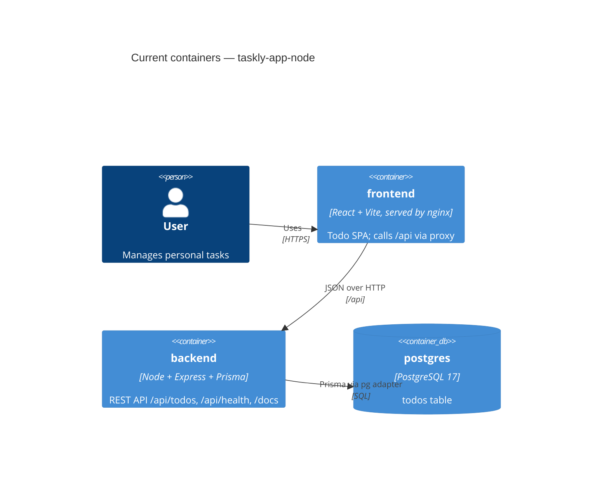

# Architecture map — taskly-app-node

> The **current** architecture (what exists today), produced by `survey` and read by
> specify / design / data-model / implement. Refresh with `survey` when the repo drifts past
> `reflects_commit`. No hand-maintained architecture doc exists; `README.md` is the run guide.

## Stack

- Language / runtime: TypeScript, Node.js >=22.12 (`backend/package.json`, `frontend/package.json` `engines`), ESM (`"type": "module"`).
- Backend: Express 5.2, Prisma 7.10 (`@prisma/adapter-pg`, PostgreSQL 17), Zod 4, swagger-ui-express (`backend/package.json`).
- Frontend: React 19, Vite 6, TanStack Query 5, styled-components 6, lucide-react icons, Storybook 10 (`frontend/package.json`).
- Tests: Vitest 4 + `@vitest/coverage-v8` in both packages; backend adds Supertest, frontend adds Testing Library + jsdom.
- Build / test / lint (run inside `backend/` or `frontend/`): `npm ci`, `npm test`, `npm run test:coverage` (reports `text, html, lcov, json-summary` → `coverage/`), `npm run typecheck`, `npm run build`; frontend also `npm run format:check` (Prettier).
- No CI exists yet (no `.github/`).

## C4 — system as it is

## Module inventory

| Module | Path | Layers | Wired at | Responsibility |
|---|---|---|---|---|
| app factory | `backend/src/factory.ts` | http composition | `backend/src/core/lifespan.ts:12` | Express app: routers, OpenAPI/docs, 404 + error handler |
| core | `backend/src/core/` | config / db / lifecycle | `backend/src/main.ts:3` | env → DB URL, Prisma client, boot table, listen + graceful shutdown |
| health | `backend/src/api/health.ts` | router | `backend/src/factory.ts:13` | `GET /api/health` (DB ping) |
| todos (be) | `backend/src/features/todos/` | router / validators / repository / mappers / types | `backend/src/factory.ts:14` | CRUD over `todos` |
| todos (fe) | `frontend/src/features/todos/` | api / hooks / components / utils / page | `frontend/src/App.tsx:2` | Todo page, filters, editor drawer, delete dialog |
| design-system | `frontend/src/design-system/` | components / theme | `frontend/src/app/AppProviders.tsx:4` | In-repo UI kit (13 components + theme) |
| shared fe | `frontend/src/{lib,hooks,components,app}` | http / query client / notice / providers | `frontend/src/main.tsx` | fetch wrapper, React Query client, notices, header |

## Conventions (cited — the rules a new feature must match)

- **Module wiring / registration:** factory functions taking dependencies — `createTodosRouter(repository)` mounted in `createApp(database)` — `backend/src/factory.ts:14`.
- **Error handling (be):** validation failures → `422 { detail: issues }` inline in the router (`backend/src/features/todos/router.ts:9`); not found → `404 { detail }`; central handler maps JSON parse/size errors and falls back to 500 — `backend/src/factory.ts:19`.
- **Error handling (fe):** `request()` turns network/HTTP errors into user-facing `Error` messages — `frontend/src/lib/http.ts:1`.
- **IDs:** integer `SERIAL`, validated by `idSchema` — `backend/prisma/schema.prisma`, `backend/src/features/todos/router.ts:8`.
- **Persistence / DB access:** repository class over a `Pick<Database,'todo'>` delegate, rows mapped by `fromModel` — `backend/src/features/todos/repository.ts:4`.
- **Migrations:** none; `initialize()` runs `CREATE TABLE IF NOT EXISTS` at boot — `backend/src/core/database.ts:12`.
- **Tests (be):** `backend/tests/*.test.ts` (outside `src`), no DB — Prisma delegates spied with `vi.spyOn` (`backend/tests/repository.test.ts:8`), routers tested with Supertest over a mock `TodoStore` (`backend/tests/router.test.ts:7`); shared data in `backend/tests/fixture.ts`. Per-file 100% threshold on validators/mappers — `backend/vitest.config.ts:15`.
- **Tests (fe):** colocated `*.test.tsx` next to source; RTL + `userEvent`, design-system replaced via `vi.mock('…/design-system', () => import('…/design-system/mocks'))` — `frontend/src/features/todos/components/TodoItem.test.tsx:7`; fixture `frontend/src/test/todoFixture.ts`; setup `frontend/src/test/setup.ts`.
- **Coverage scope:** frontend excludes `design-system/**`, `index.ts`, types, `queryKeys.ts`, `queryClient.ts` — `frontend/vite.config.ts:13`; backend excludes `types.ts`, `generated/**` — `backend/vitest.config.ts:10`.
- **Code style:** backend dense single-line style, `.js` import suffixes in src, `.ts` in tests; frontend Prettier, no semicolons, single quotes — `frontend/.prettierrc.json`.
- **Inter-module communication:** direct calls in-process; FE↔BE over `/api` JSON (Vite proxy `frontend/vite.config.ts:6`, nginx in Docker `frontend/nginx.conf`).
- **UI / styling:** styled-components with a typed `theme` — see §Frontend.

## Datastores

| Store | Engine | Accessed via | Notes |
|---|---|---|---|
| `todos` table | PostgreSQL 17 (`compose.yaml`) | Prisma client `backend/src/core/database.ts:5` | Schema in `backend/prisma/schema.prisma`; client generated to `backend/src/generated/prisma` on `postinstall` |

## Frontend / UI foundation

- **Component library / design system:** in-repo `frontend/src/design-system/components/` — Alert, AppHeader, Badge, Button, Card, Checkbox, CheckboxGroup, Drawer, Heading, IconButton, Input, Select, Text; each with `.styles.ts`, `.types.ts`, `.stories.tsx` (no unit tests; excluded from coverage).
- **Design tokens:** `frontend/src/design-system/theme/theme.ts` (colors, layout, …), typed via `theme/styled.d.ts`.
- **Styling approach:** styled-components + `ThemeProvider` — `frontend/src/app/AppProviders.tsx:16`.
- **Shared primitives:** exported from `frontend/src/design-system/index.ts`; test doubles in `frontend/src/design-system/mocks.tsx`.
- **State / data-fetching:** TanStack Query; hooks per operation (`frontend/src/features/todos/hooks/useTodosQuery.ts:5`), keys in `api/queryKeys.ts`, API object `api/todos.ts`.
- **Closest UI precedent:** `frontend/src/features/todos/components/TodoItem.tsx` (+ its test).

## Where things live / closest precedents

- A new backend feature → `backend/src/features/<name>/{router,validators,repository,mappers,types}.ts`, mounted in `backend/src/factory.ts`, tests in `backend/tests/`, modelled on todos.
- A new screen / UI component → `frontend/src/features/<name>/components/`, composed from the design system, colocated test, modelled on `TodoItem.tsx`.

## Baseline coverage (at `0c72f72`)

| Package | Stmts | Branches | Funcs | Lines | Uncovered |
|---|---|---|---|---|---|
| backend (48 tests) | 30.2% | 33.3% | 40.6% | 33.0% | `factory.ts`, `main.ts`, `api/health.ts`, `core/config.ts`, `core/lifespan.ts`, most of `router.ts` branches |
| frontend (18 tests) | 46.4% | 43.8% | 40.3% | 47.7% | `lib/http.ts`, all `features/todos/hooks/*`, `AppProviders.tsx`, `TodoEmptyState.tsx`, `TodoList.tsx`, parts of `TodosPage.tsx`, `api/todos.ts`, `utils/todos.ts` |

## Constraints & known tech-debt

- Node >=22.12 required; Node 20 fails to run Vitest 4 — CI must pin Node 22.
- Backend tests need `prisma generate` (runs on `npm ci` postinstall) but **no database**.
- No ESLint; static checks = `tsc --noEmit` (+ Prettier in frontend).
- No migration tool; schema change = edit `initialize()` + `schema.prisma` in lockstep.
- No CI / GitHub workflows yet.

## Reconciliation with the authored architecture doc

No authored architecture doc; this map is the current reference (`README.md` covers run commands only and agrees with the commands above).
