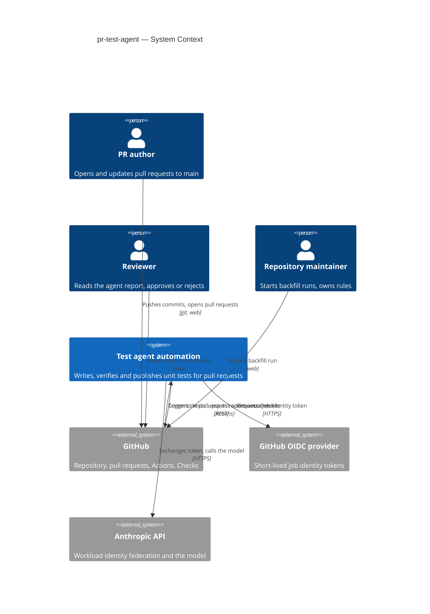
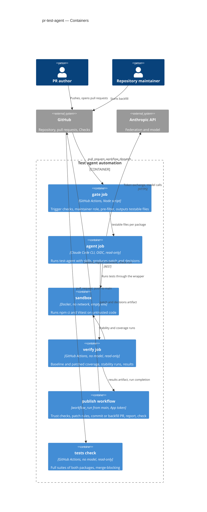
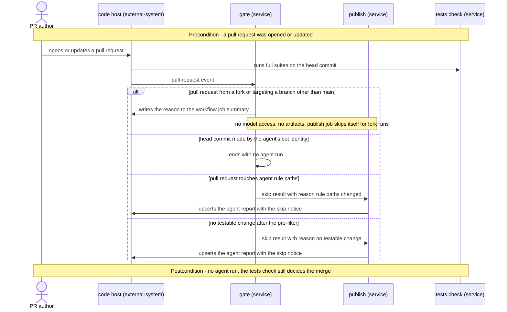
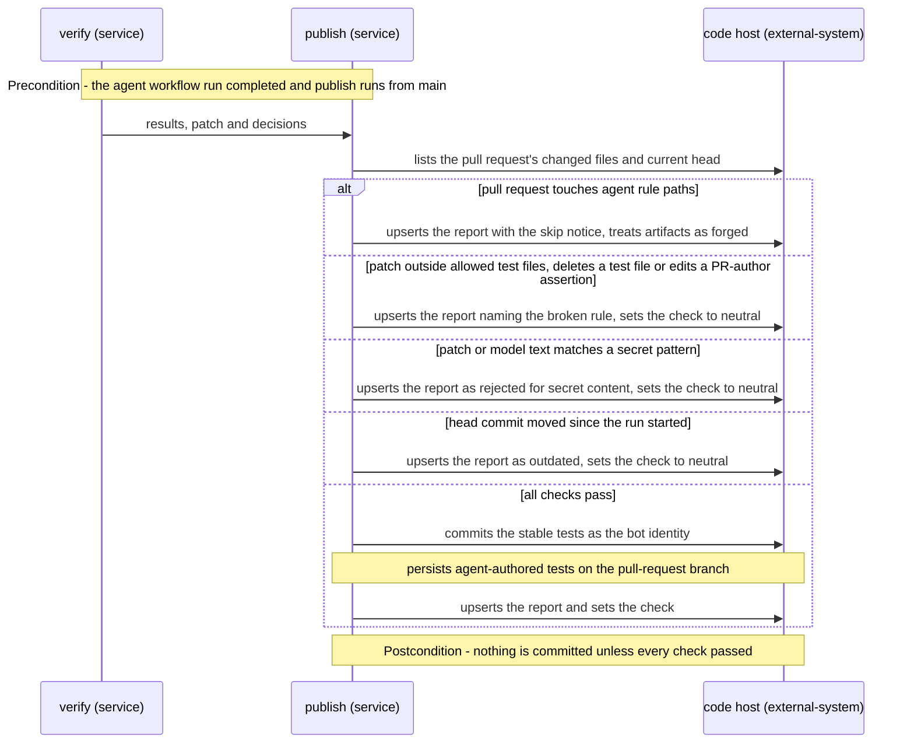
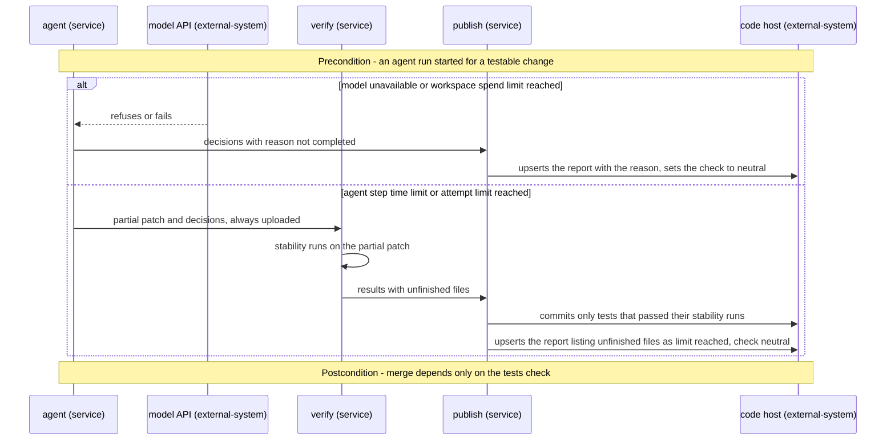
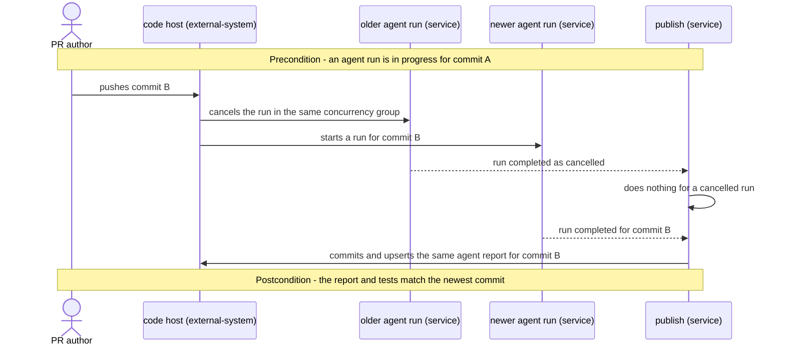
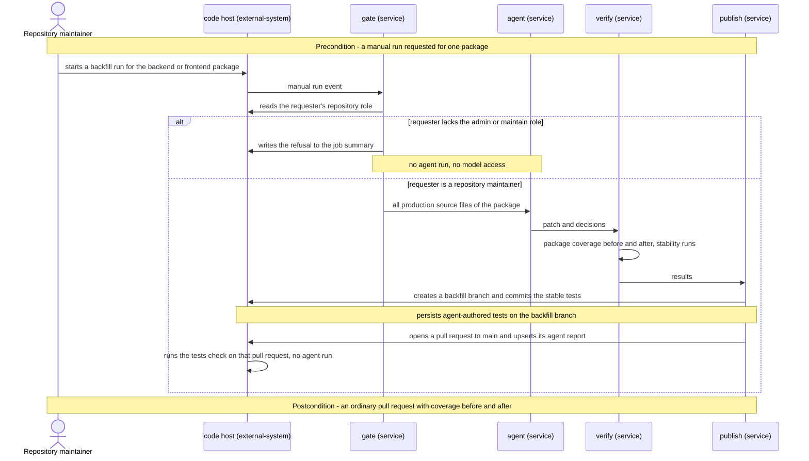

# Software Architecture Document — pr-test-agent

## 1. Introduction and goals

**Intent.** A test agent, defined in this repository as a Claude Code agent plus four reusable skills, runs on every same-repository pull request to main and writes or updates unit tests for the testable changes in both packages (backend, frontend). It proves them by running them and publishes one agent report on the pull request. A repository maintainer can run the same agent and skills on demand to backfill a package. The workflow is split by privilege: the part that talks to the model and runs pull-request code holds no write rights and no reachable credentials, and the part that writes to the repository uses no model and never runs pull-request code.

**Top-3 quality goals (1-liners; full scenarios in §10):**

1. **Security boundary.** A hostile pull request cannot gain repository write access, read credentials or get anything outside allowed test files committed.
2. **Result fidelity.** Every number in the agent report and every committed test is backed by a run that no model controls: only stable, passing tests are committed.
3. **Bounded, non-blocking runs.** Each agent run has a hard time and attempt cap, and the agent never blocks a merge; the merge rests on the tests check.

**Stakeholders.**

| Role | Interest | Sign-off owner? |
|---|---|---|
| PR author | Gets tests for their change without writing them all; never has their assertions rewritten | No |
| Reviewer | Reads the agent report to decide whether to trust agent-authored tests | No |
| Repository maintainer | Owns the agent's rules, the GitHub App, federation rules and branch protection; starts backfill runs | Yes |
| Security Lead | New automation identity with write rights and model access | Yes |
| Tech Lead | SAD approval | Yes |

## 2. Constraints

**Technical.**
- GitHub repository, pull requests and GitHub Actions are mandated by the assignment (spec §1 decision override).
- Packages: `backend/` (Node ≥ 22.12, Express 5.2, Prisma 7.10, Vitest 4 + `@vitest/coverage-v8`, Supertest) and `frontend/` (React 19, Vite 6, Vitest 4, Testing Library, jsdom). Node 22 must be pinned; Vitest 4 does not run on Node 20 (`docs/architecture-map.md`, Constraints).
- Backend tests need `prisma generate` (runs as the `postinstall` script) but no database.
- Model access only through GitHub OIDC → Anthropic workload identity federation. The repository variables `ANTHROPIC_FEDERATION_RULE_ID`, `ANTHROPIC_ORGANIZATION_ID`, `ANTHROPIC_SERVICE_ACCOUNT_ID` and `ANTHROPIC_WORKSPACE_ID` are already set; no stored API key. The existing rule matches the `pull_request` event to main only; backfill needs a second rule for manual runs on main.
- Runner: GitHub-hosted `ubuntu-latest`, which has Docker. The sandbox is a Docker container.

**Organisational.**
- Single developer; the assignment deliverables also include `SOLUTION.md` and a demo pull request (handled at `ship`).

**Conventions.**
- Test layout from `docs/architecture-map.md`: backend tests in `backend/tests/**/*.test.ts`, frontend tests colocated as `frontend/src/**/*.test.{ts,tsx}`; shared fixtures and setup are off-limits to the agent (glossary «Allowed test files»).
- Automation scripts are plain Node ESM with no npm dependencies (repo is ESM, Node 22 stdlib suffices); this includes the sandbox wrapper.

**Regulatory / external.**
- No personal data (spec §6.1). Security review required: new automation identity with write rights and model access.

## 3. Context and scope

The test agent sits between GitHub (pull-request events, the repository, the PR conversation) and the Anthropic API. PR authors and repository maintainers trigger it, reviewers read its report. The trust boundary runs through the workflow itself: pull-request content (code, title, body, comments) is untrusted input, and only the publish stage, defined on main, may write.

<!-- brownfield: docs/architecture-map.md (reflects 0c72f72, only docs changed since) — two npm packages, Vitest in both, no CI yet -->

**External systems (in / out):**

| Actor or system | Type | Interaction |
|---|---|---|
| PR author | Person | Opens and updates same-repository pull requests to main |
| Reviewer | Person | Reads the agent report and the checks; approves or rejects |
| Repository maintainer | Person | Starts backfill runs; owns the App, rules and branch protection |
| GitHub (repository, pull requests, Actions, Checks) | System (external) | Delivers events, runs the workflows, stores commits, comments and check results |
| GitHub OIDC provider | System (external) | Issues short-lived identity tokens to workflow jobs |
| Anthropic API | System (external) | Exchanges the OIDC token for a short-lived model credential; serves the model |

**C4 Context (L1):**



## 4. Solution strategy

**Target surface.** `worker` — the feature is a CI automation: event-triggered jobs with no request/response API and no UI. One surface, so §5 draws the jobs of that one worker as its containers.

**Top strategic choices (the seeds for ADRs):**

1. **Claude Code CLI as the agent runtime** ([ADR-0001](adr/0001-run-claude-code-cli-headless-with-repo-agent-and-skills.md)). The workflow invokes `claude -p` headless with the repository's own agent definition (`.claude/agents/test-agent.md`) and skills (`.claude/skills/*`), so the same agent and skills serve pull requests, backfill and local runs. The CLI lets the workflow control the exact environment and tool allowlist the agent gets, which the security boundary needs.
2. **Privilege-split pipeline: gate → agent → verify in an unprivileged workflow, publish in a separate `workflow_run` workflow** ([ADR-0002](adr/0002-split-unprivileged-agent-and-verify-from-workflow-run-publish.md)). The model-using job and the job that measures results hold only read access and never get write rights. Untrusted code (pull-request code, agent-authored tests, package lifecycle scripts) runs only inside a Docker sandbox with no environment, no credentials and no network; dependencies are fetched beforehand with `npm ci --ignore-scripts`, which runs no pull-request code. The publish workflow is triggered by `workflow_run`, so GitHub always runs its definition from main. It runs no pull-request code and no model, re-validates the patch against the rules, and alone holds write rights.
3. **A dedicated GitHub App as the write identity** ([ADR-0003](adr/0003-publish-with-github-app-installation-token.md)). Publish mints a short-lived installation token, so agent commits trigger the tests check (AC-10) and are attributable to the bot, which the gate uses to avoid agent loops (AC-11).
4. **Rules come from main; a pull request cannot change the rules of its own run** ([ADR-0004](adr/0004-take-agent-rules-from-main-and-skip-prs-touching-them.md)). Publish scripts, the allowlist and the publish workflow are always main's (by construction of `workflow_run`). The agent job loads the agent definition and skills from a main checkout. Pull requests touching `.github/` or `.claude/` get no agent run (the report says why), and CODEOWNERS requires the maintainer's review on those paths. Because `test-agent.yml` itself comes from the pull request, publish enforces this rule independently: it lists the pull request's changed files through the API, and if any is under `.github/` or `.claude/` it treats every artifact of the run as forged and posts only the skip notice. Without such paths the run's workflow equals main's, so its artifacts are trusted to that degree. This resolves spec §8 open question 1.

Each tactical decision in later sections traces to one of these seeds.

## 5. Building block view

A pipeline of jobs, each with the least privilege its step needs, connected only by workflow artifacts. Model-authored output (the patch and the decisions file) is treated as untrusted data by every later job. All deterministic logic lives in dependency-free Node scripts, loaded from main by the jobs that enforce rules.

**Internal decomposition:**

```
.claude/
├── agents/test-agent.md                 the custom agent: role, workflow, hard rules, output contract
└── skills/
    ├── analyze-changes/SKILL.md         classify changed files, decide write / update / skip per file
    ├── backend-unit-tests/SKILL.md      Vitest + Supertest conventions for backend/tests
    ├── frontend-unit-tests/SKILL.md     Vitest + Testing Library conventions, colocated tests
    └── test-report/SKILL.md             decisions.json contract: decisions, reasons, defects, skills used
.github/
├── CODEOWNERS                           maintainer review on .github/ and .claude/
├── workflows/
│   ├── tests.yml                        tests check: full suites, both packages, no model, read-only
│   ├── test-agent.yml                   gate → agent → verify (pull_request + workflow_dispatch backfill)
│   └── test-agent-publish.yml           publish (workflow_run; environment-protected App key)
└── scripts/                             Node ESM, no dependencies
    ├── prefilter.mjs                    testable-change classification (glossary pre-filter list)
    ├── sandbox.mjs                      spawns docker run --network none, empty env, repo mounted
    ├── check-patch.mjs                  allowed test files, no deletions, add-only on PR-author tests
    ├── diff-coverage.mjs                lcov.info × changed lines → per-package diff coverage; «measured» = lcov file exists, not the exit code
    ├── stability.mjs                    3 consecutive runs per agent-touched test file, drop unstable
    └── report.mjs                       render the agent report from results.json + decisions.json
```

**C4 Container (L2):**



## 6. Runtime view

**Critical flow 1: pull request with testable changes (happy path).** The full per-AC set of flows is added by the `sequences` stage.

```mermaid
sequenceDiagram
    actor Author as PR author
    participant GH as GitHub
    participant Gate as gate job
    participant Agent as agent job
    participant Box as sandbox
    participant Verify as verify job
    participant Pub as publish workflow
    participant Tests as tests check
    participant API as Anthropic API

    Author->>GH: pushes a commit to the pull request
    GH->>Tests: runs full suites on the head commit
    GH->>Gate: pull-request event
    Gate->>Gate: same repo, base main, not a bot commit, no rule paths touched
    Gate->>Agent: testable files per package
    Agent->>Box: installs dependencies with no credentials
    Agent->>API: exchanges job identity for a model credential
    loop per testable file, up to 3 fix attempts
        Agent->>API: test-agent with skills writes or updates tests
        Agent->>Box: runs the affected tests
        Box-->>Agent: pass or fail output
    end
    Agent->>Verify: patch and decisions
    Verify->>Box: applies patch, runs each touched test file 3 times
    Verify->>Box: coverage run with the stable tests only
    Verify->>Pub: results with measured counts and diff coverage
    Pub->>Pub: re-checks patch rules and that the head commit has not moved
    Pub->>GH: commits stable tests as the App
    Pub->>GH: upserts the agent report and sets the advisory check
    GH->>Tests: runs full suites on the agent commit
    GH->>Gate: pull-request event for the agent commit
    Gate->>Gate: bot commit, so no agent run
```

**Further flows for `sequences`:** AC-02 and rule-path skip notice, AC-07 fork and non-main stop, AC-09 not completed, AC-12 limit reached, AC-16 backfill branch and pull request, AC-17 non-maintainer refused.

**Critical flow 2: rejection and outdated result.** If `check-patch` finds a path outside allowed test files, a deleted test file or a changed line in a PR-author test, publish commits nothing and the report names the rule (AC-05). If the pull request head moved since the agent run started, publish commits nothing and reports the result as outdated (AC-13). The newer run, started by the new push, replaces the cancelled one (concurrency group per pull request, AC-11).

### Flow 2: gate stops the run (US-02, US-05)



### Flow 3: per-file outcome in agent and verify (US-01, US-03, US-04)

```mermaid
sequenceDiagram
    participant Agent as agent (service)
    participant Box as sandbox (service)
    participant Model as model API (external-system)
    participant Verify as verify (service)

    Note over Agent,Box: Precondition - dependencies fetched without scripts, lifecycle steps ran in the sandbox
    Note over Box: no network, no environment, no credentials
    loop each testable file, up to 3 fix attempts
        Agent->>Model: writes or updates tests for the file
        Agent->>Box: runs the affected test file
        Box-->>Agent: pass or fail output
    end
    alt test fails and explicit evidence shows the code is wrong
        Agent->>Agent: drops the test, records a suspected defect with location and expected versus actual
    else test fails and intent is unclear
        Agent->>Agent: drops the test, records intent unclear
    else a test the PR author changed in this pull request fails
        Agent->>Agent: keeps its assertions, may only add cases, records a flag for the author
    else a main-branch test fails because the change is intended
        Agent->>Agent: updates its assertions, records decision update with the reason
    end
    Agent->>Verify: patch and decisions
    Verify->>Box: runs each touched test file 3 times
    alt a test file fails in any of the 3 runs
        Verify->>Verify: removes it from the patch, marks it unstable
    end
    Verify->>Box: coverage run with the stable tests
    alt coverage file missing for a package
        Verify->>Verify: marks diff coverage not measured for that package
    else diff coverage below the target
        Verify->>Verify: marks target missed, lists uncovered changed lines
    end
    Note over Agent,Verify: Postcondition - results hold only measured numbers and stable tests
```

### Flow 4: publish trust checks and rejection (US-05, US-01)



### Flow 5: run not completed or limit reached (US-06, US-07)



### Flow 6: new push during a run (US-08)



### Flow 7: backfill (US-09)



**AC coverage (sequences):** AC-01, AC-03, AC-10 → flow 1 · AC-02, AC-07 → flow 2 · AC-04, AC-04b, AC-06, AC-06b, AC-14, AC-15, AC-18 → flow 3 · AC-05, AC-13 → flow 4 · AC-08 → flow 3 (sandbox) and flow 4 (secret scan) · AC-09, AC-12 → flow 5 · AC-11 → flows 1 and 6 · AC-16, AC-17 → flow 7. Every user story US-01…US-09 has at least one flow. No new participants beyond §3/§5; no persistent data store, so no index hints for `data-model`.

## 7. Deployment view

Everything runs on GitHub-hosted `ubuntu-latest` runners, with no long-lived infrastructure. Workflows: `tests.yml` (on `pull_request` incl. forks, and `push` to main), `test-agent.yml` (on `pull_request` to any branch and `workflow_dispatch`; the gate stops fork and non-main pull requests and writes the reason to the workflow job summary; concurrency group `test-agent-<pr number or package>`, `cancel-in-progress: true`), `test-agent-publish.yml` (on `workflow_run` of `test-agent.yml` completed; its job runs only if `workflow_run.head_repository` is this repository and the event is `pull_request` or `workflow_dispatch`, evaluated before it enters environment `test-agent-publish`, which holds the App private key and is restricted to the main branch; concurrency group per pull request).

**Time budget (whole agent run ≤ 15 min):** gate ≤ 1 min; agent job: dependency install, then the `claude` step with its own timeout of 9 min, and the partial patch and decisions are uploaded with `if: always()`; verify ≤ 4 min; publish ≤ 1 min.

**Prerequisites (set up once by the repository maintainer):**
- GitHub App «taskly-test-agent» with Contents and Pull requests read/write, Checks read/write, installed on this repository only; `TEST_AGENT_APP_ID` variable and `TEST_AGENT_APP_PRIVATE_KEY` secret in the `test-agent-publish` environment.
- Second Anthropic federation rule for `workflow_dispatch` on main (backfill), its ID as `ANTHROPIC_BACKFILL_FEDERATION_RULE_ID`.
- Branch protection on main: tests check required; CODEOWNERS review required (spec §8 open question 2 tracks the rest).

**Monitoring:**
- Job durations and outcomes in the Actions UI; the agent report records per-run counts.
- Spend is visible per run in the `taskly-ci` workspace usage; the workspace spend limit is the hard cost stop.

**Scaling thresholds:** N/A — one run per pull request at a time; GitHub-hosted runner concurrency is the only limit.

## 8. Crosscutting concepts

| Concept | Convention | Where defined |
|---|---|---|
| Credentials | OIDC → Anthropic token minted in the agent job only; Claude process gets an allowlisted env (no `GITHUB_TOKEN`; `ACTIONS_*` only if the federated auth must refresh, settled at `implement` per §11); `persist-credentials: false` on every checkout; App token only in publish; publish scans the patch and all model text for secret patterns and rejects the run on any hit | ADR-0002, ADR-0003 |
| Sandboxing | Dependencies fetched with `npm ci --ignore-scripts` (network, no pull-request code runs); lifecycle steps (`npm rebuild`, `prisma generate`) and all tests through `sandbox.mjs`: `docker run --rm --network none`, empty environment, only the working copy mounted | ADR-0002 |
| Agent tool allowlist | Read, Glob, Grep only inside the workspace (denied for `/proc`, `$HOME`, `$RUNNER_TEMP`); Edit/Write only on allowed test files; Bash only for the sandbox wrapper; no web tools | ADR-0001 |
| Artifacts between jobs | `testable.json` (gate), `agent.patch` + `decisions.json` (agent), `results.json` (verify); all treated as untrusted by later jobs, schema-validated in publish | here |
| Report | One PR comment found by a hidden marker `<!-- test-agent-report -->`, upserted; numbers rendered only from `results.json`; model text escaped and length-capped | spec AC-03, AC-15 |
| Check result | Check run «test-agent»: `success` when all handled and target met; `neutral` on target missed, not completed, rejected or outdated; never blocks merge | spec AC-09, AC-18 |
| Limits | Whole agent run ≤ 15 min split per §7 time budget; `claude` step timeout 9 min with partial results always uploaded; ≤ 3 fix attempts per test file (agent instructions, enforced by `run-tests.mjs` refusing a 5th run of one file; Claude `--max-turns` and the per-run budget stop the whole run as `attempt_limit`); stability = 3 consecutive passing runs | spec §6 |
| Logging | Raw model transcripts are not uploaded; logs carry counts and file names only | spec §6.1 |
| Errors | Any failure in agent or verify → publish still runs and posts a «not completed» report with the reason; publish does nothing when the triggering run was `cancelled` or when the pull request's head is already the agent's own commit on top of the analysed one (a re-run); when the author pushed meanwhile, it commits nothing and reports `test_agent.outdated` (AC-13) | spec AC-09, AC-11, AC-13 |
| Run duties | gate: trigger checks, maintainer role, pre-filter, skip reason. verify: baseline coverage (backfill: package before), patched coverage, stability. publish: trust checks, the no-model skip notice (AC-02, rule paths), patch rules, commit to the pull-request branch or create the backfill branch and open its pull request (AC-16), report, check | here |
| ID strategy / i18n / events | N/A — no persistent data, English-only report | — |

## 9. Architecture decisions

| # | Title | Status | Section |
|---|---|---|---|
| 0001 | Run Claude Code CLI headless with the repository's agent and skills | Accepted | §4 |
| 0002 | Split unprivileged agent and verify jobs from a workflow_run publish | Accepted | §4 |
| 0003 | Publish with a GitHub App installation token | Accepted | §4 |
| 0004 | Take agent rules from main and skip pull requests that touch them | Accepted | §4 |

ADR files live under `docs/features/pr-test-agent/adr/NNNN-<title>.md`.

## 10. Quality requirements

**QG-1. Security boundary**
- **When:** a pull request contains test code that dumps the environment and tries the network, and a PR body instructing the agent to edit production code.
- **Then:** the sandboxed test sees no credentials and no network; any agent change outside allowed test files is rejected by publish and nothing is committed (spec «Boundary violations committed» target: 0 agent commits touching anything other than allowed test files, and 0 credentials in reports or logs).
- **How verify:** a hostile demo pull request run end to end; `check-patch.mjs` self-check with a forbidden path, a deletion and an edited author assertion.

**QG-2. Result fidelity**
- **When:** the agent run completes.
- **Then:** report fidelity is 100% of numbers come from measured output; each kept test has 3 consecutive passing runs; diff coverage target ≥ 80% of changed lines per package is reported as met or missed (backfill: package line coverage before vs after, both measured by verify).
- **How verify:** compare the report against `results.json` of the verify job; `diff-coverage.mjs` self-check on a fixed coverage file and diff.

**QG-3. Bounded, non-blocking runs**
- **When:** an agent run on a pull request (or a package for backfill).
- **Then:** agent run wall time ≤ 15 min hard cap; p95 ≤ 10 min; tests check duration ≤ 5 min p95; ≤ 3 fix attempts per test file; cost per agent run ≤ USD 2; concurrent runs per pull request: 1 (newer cancels older); merge depends only on the tests check.
- **How verify:** workflow job durations and job timeout; workspace usage per run; branch protection lists only the tests check as required.

## 11. Risks and technical debt

| Risk / debt | Severity | Mitigation | Owner |
|---|---|---|---|
| A same-repository collaborator can edit `test-agent.yml` in a pull request: use the agent job's model access outside the rules, or forge the verify artifacts | Medium | Publish (always main's) rejects every artifact of a run whose pull request touches `.github/` or `.claude/`; model access is spend-capped by the workspace limit; CODEOWNERS on `.github/`; same-repo authors already hold write access | Repository maintainer |
| Claude Code headless auth through Anthropic workload identity federation (resolved at `implement`, T10) | Low | One-shot exchange in its own step: GitHub JWT (audience `https://api.anthropic.com`, ~5 min) → `sk-ant-oat01` token (≤ 2× JWT remaining, ~10 min) passed as `ANTHROPIC_AUTH_TOKEN` to an `env -i` claude process; covers the 9-min step with no refresh, so `ACTIONS_*` never reach the agent | Repository maintainer |
| Claude Code loads `CLAUDE.md` / `.mcp.json` / `.claude/` from the working copy (found at `implement`, T10) | High | Treated as rule paths by the gate (no agent run), deleted and `.claude/` replaced from main before the run, `--strict-mcp-config`; reads outside the working copy blocked (`blockReadsOutsideWorkingDirectories`) | Repository maintainer |
| The model's own process runs on the runner (outside the sandbox) and reads untrusted pull-request text | Medium | Tool allowlist (no general shell, no web), Edit/Write limited to test paths, env allowlist; publish re-validates everything | Repository maintainer |
| Package lifecycle scripts are pull-request-controlled code | Low | Fetch with `npm ci --ignore-scripts`, then run `npm rebuild` and `prisma generate` inside the sandbox with no network; Prisma engines must already be in the fetched packages | Repository maintainer |
| Backend coverage config has per-file thresholds, so a coverage run can exit non-zero while still writing lcov | Low | Pass `--coverage.reporter=lcov` on the command line; judge «measured» by the lcov file, not the exit code | Repository maintainer |
| Branch protection settings (stale approvals after an agent push) | Open question | Resolve before `sdd:ship`; spec §8 open question 2 | Repository maintainer |

**Accepted debt (acceptable in v1, plan to fix later):**
- One agent run handles both packages sequentially; per-package parallel jobs if wall time approaches the cap.
- No retention of agent transcripts for audit beyond the report.

## 12. Glossary

| Term | Meaning |
|---|---|
| Agent run | One test-agent execution for one head commit or one backfill package (CONTEXT) |
| Agent report | The single upserted pull-request comment with decisions, results and coverage (CONTEXT) |
| Allowed test files | `backend/tests/**/*.test.ts`, `frontend/src/**/*.test.{ts,tsx}` — create or modify only (CONTEXT) |
| Tests check | The deterministic, merge-blocking full-suite run with no model (CONTEXT) |
| Testable change | A changed production source file (for backfill: any production source file in the chosen package) that passes the pre-filter (CONTEXT) |
| Sandbox | The Docker container with no network, no environment and no credentials in which untrusted code runs |
| Publish workflow | The `workflow_run`-triggered workflow, always defined on main, that alone holds write rights |
