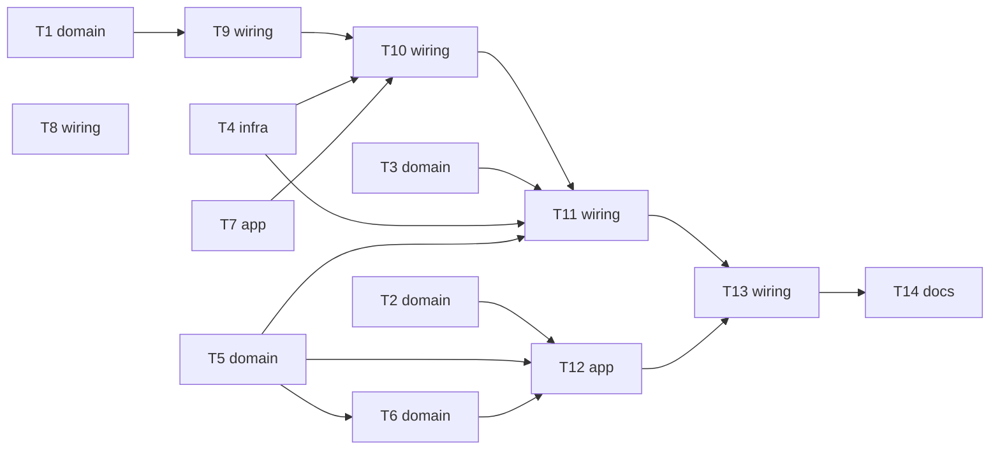

# Epic — pr-test-agent

> **Spec:** [spec.md](../spec.md) · **Design:** [sad.md](../sad.md) · **Contract:** [events.md](../contracts/events.md) · **ADRs:** [adr/](../adr/) · Data model: none (no datastore)

## Goal

Every testable change in a same-repository pull request to main gets agent-authored, stable unit tests and one agent report with measured results, and a maintainer can backfill a package the same way (spec §2). The agent can never become a path to write access, credential theft or weakened tests.

## Scope

- **In:** `.claude/` agent + 4 skills, `.github/scripts/` deterministic Node scripts, three workflows (`tests.yml`, `test-agent.yml`, `test-agent-publish.yml`), CODEOWNERS, setup guide.
- **Out:** fixing production code, fork pull requests, end-to-end / visual / load tests, replacing human review (spec §3). `SOLUTION.md` and the demo pull request belong to `ship`.

## Task map

## Tasks

See [tracker.md](./tracker.md) for status. Machine contract: [tasks.json](../tasks.json).

| # | Task | Layer | Blocked by | DoD (short) |
|---|---|---|---|---|
| T1 | [Implement the pre-filter and gate decision script](./prefilter-and-gate-decision.md) | domain | — | `node --test .github/scripts/prefilter.test.mjs` passes, covering every edge case above |
| T2 | [Implement the patch rule check and secret scan](./check-patch-rules.md) | domain | — | `node --test .github/scripts/check-patch.test.mjs` passes for every edge case |
| T3 | [Implement diff coverage from lcov and the git diff](./diff-coverage.md) | domain | — | `node --test .github/scripts/diff-coverage.test.mjs` passes; a fixture with 4/5 lines covered yields 80% and `target_met: true` |
| T4 | [Implement the sandbox wrapper and stability runner](./sandbox-and-stability.md) | infra | — | `node --test .github/scripts/stability.test.mjs` passes on a machine with Docker, including the no-env and no-network checks |
| T5 | [Implement artifact schema validators](./artifact-schemas.md) | domain | — | `node --test .github/scripts/artifacts.test.mjs` passes |
| T6 | [Render the agent report, outcome code and check conclusion](./report-renderer.md) | domain | T5 | `node --test .github/scripts/report.test.mjs` passes; every number in the output is read from `results` |
| T7 | [Write the test agent definition and its four skills](./agent-and-skills.md) | app | — | Running `claude -p` locally with the agent on a sample change in `backend/src` produces a passing test in `backend/tests` and a `decisions.json` that `artifacts.mjs` accepts (T5 validator) |
| T8 | [Add the deterministic tests check workflow](./tests-check-workflow.md) | wiring | — | Workflow passes on a PR in GitHub; job names are stable for branch protection |
| T9 | [Create the agent workflow with triggers, concurrency and the gate job](./agent-workflow-gate.md) | wiring | T1 | On a test PR the gate outputs `run` for a source change and `skip` for a docs-only change; a fork-style event stops with a summary line |
| T10 | [Add the agent job: federated model access and a locked-down Claude run](./agent-job.md) | wiring | T9, T4, T7 | On a test PR the job uploads a patch and a valid decisions.json; `env` printed from a sandboxed test shows no `ACTIONS_*`, `GITHUB_TOKEN` or model credential |
| T11 | [Add the verify job: stability runs and measured coverage](./verify-job.md) | wiring | T10, T3, T4, T5 | On a test PR `results.json` validates with `artifacts.mjs` and its numbers match a manual `vitest --coverage` run |
| T12 | [Implement the publish orchestration script](./publish-script.md) | app | T2, T5, T6 | `node --test .github/scripts/publish.test.mjs` passes for every Publish outcome code |
| T13 | [Add the workflow_run publish workflow with the App token](./publish-workflow.md) | wiring | T11, T12 | On a test PR the App commits the tests, the report comment appears, the check run is set, and `tests` runs on the agent commit |
| T14 | [Add CODEOWNERS and the setup prerequisites document](./codeowners-and-setup.md) | docs | T13 | A PR touching `.github/` requests the code owner; the setup guide is followed once end to end and the first agent run succeeds |

## Risks / Hard rules

- Untrusted code runs only through `sandbox.mjs` (no network, empty env) — sad §8 Sandboxing.
- No job that talks to the model holds write rights; only publish (from main, App token) writes — ADR-0002, ADR-0003.
- Report numbers come only from `results.json` — spec §6 Report fidelity.
- Whole agent run ≤ 15 min; ≤ 3 fix attempts per test file; 3 consecutive passing runs — spec §6.
- Open risk: Claude Code federated auth mechanism — spiked first in T10 (sad §11).
